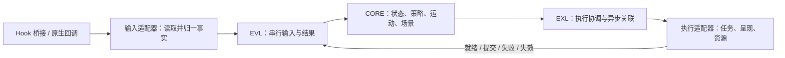

# 米窗（BetterYAMF）

米窗是基于 BetterYAMF / [reYAMF](https://github.com/JuanArton/reYAMF) 持续开发的 Android 小窗模块，通过 Xposed 在 Launcher 与系统窗口管理之间接入小窗能力。交互参考澎湃 OS，动画参考 ColorOS，并使用公共的弹簧与场景逻辑实现运动。

当前重点包括：

- 从应用上滑进入最近任务手势，拖向屏幕右上角投放区；最终显示为竖屏时进入 mini，横屏时进入普通小窗。点击 mini 展开。
- 小窗拖动、缩放、磁吸，以及下拉预览、回弹和全屏交还动画。
- 小窗慢速拖入左右侧边即可收起为半隐藏的应用图标，点击恢复；多个图标自动分隔。竖屏四角保留 mini，横屏只允许普通小窗和侧边图标。
- LOS 24 横屏点击普通通知时，以原通知 Activity/深链打开可输入的居中竖屏小窗并淡入；沿用通知上浮退出，目标可交互帧提交后删除通知，失败或已有新消息更新时保留通知。通知到达本身不弹小窗，持续服务、媒体和通话等通知保留系统行为。
- 从最近任务源画面过渡到真实小窗内容，保持外壳、内容和输入区域同步。
- 侧边栏、应用列表和已适配 Launcher 的小窗菜单入口。

## 运行与安装

工程声明的最低版本是 Android 13（API 33），当前原生交接与绘制同步的验证基线是 **LineageOS 24.0 的 Quickstep / Launcher3 与系统窗口后端**。最低 API、作用域中的包名或可找到的类名，都不能单独证明设备兼容。当前 Android 17 / Pixel Launcher 17、907 仅为源码核对候选，尚未完成 PixelOS 真机验证；Android 15/16 的组合保留待适配入口。

安装需要支持本工程 Xposed 接口的框架，例如 LSPosed。当前 Android 17 实现需要同时启用 **`android`、`com.android.systemui` 和实际承担最近任务手势的 Launcher**。SystemUI 承载 Shell，小窗后端会等待同一构建的 Shell 隔离确认；缺少其作用域或仍驻留旧代码时，后端不宣告入口可用。侧边栏等应用侧浮层按界面提示授予悬浮窗权限。

安装或更新 APK 后，应在 Hook 框架中检查模块及所需作用域。APK 更新成功不等于 Launcher / `system_server` 已加载新代码；驻留版本的生效方式由所用框架决定。

顶栏及状态卡片目前显示“暂不支持检测”，模块激活及作用域完整性检测将在迁移至 **libxposed 102** 后补充。这一提示不代表模块未激活，也不根据服务连接或后端就绪状态推断作用域是否完整。

当前没有额外的进程完整性探测、回报或检测定时器。设置、窗口命令所需的应用服务连接按启动、前台及 UID 活跃事件建立，不进行周期轮询。悬浮窗权限仅在用户主动启动侧边栏时申请，不影响查看应用界面。

## 架构

核心原则：**CORE 决定当前应显示的完整场景及其随时间的运动；平台适配器负责操作真实输入、任务、表面和缓冲区。**



EVL（事件抽象层）和 EXL（执行抽象层）位于 `window-runtime`，形成同一运行时内的事件与效果闭环。它们不各自维护另一套小窗产品状态机。

### 模块依赖

```text
app
  └─ implementation(window-runtime)
       ├─ api(window-api)
       └─ implementation(window-core)
                              └─ implementation(window-api)
```

| 模块 | 职责 |
|---|---|
| [`window-api`](window-api) | 纯 Kotlin/JVM 公共契约：输入、系统事实、完整场景、会话句柄和执行端口 |
| [`window-core`](window-core) | 纯 Kotlin/JVM 产品逻辑：入口判定、模式、布局、输入许可、磁吸、弹簧、全屏与内容替换轨迹 |
| [`window-runtime`](window-runtime) | 纯 Kotlin/JVM 运行时：串行消息泵、效果执行、帧时钟请求、取消及过期结果隔离 |
| [`app`](app) | Android 应用与平台适配：Hook、Launcher、任务后端、绘制、跨进程传输和原生资源管理 |
| [`android-stub`](android-stub) | 供 Android 编译使用的内部接口声明 |

`app` 的编译依赖不包含 CORE，适配器只使用 API 和运行时工厂。前三个模块不依赖 Android、Hook 框架、反射或系统时钟；帧时间由平台调度器传入。架构边界由自动化测试检查。

### Hook 如何接入事件层

Launcher 手势的主要路径是：

```text
HookLauncher → Android 大版本 / Launcher 安装入口
  → NativeHooks / QuickstepHookInstaller → LauncherGestureAdapter
  → LauncherEntryHandle.onInput(EntryInput)
  → window-runtime → CORE
  → LauncherEntryPort → 原生投放提示或源交接预备
```

[`NativeHooks`](app/src/main/java/com/buildsession/betterYAMF/xposed/hook/bridge/NativeHooks.kt) 封装方法注册、回调和原始方法调用；[`HookLauncher`](app/src/main/java/com/buildsession/betterYAMF/xposed/hook/HookLauncher.kt) 按精确 SDK、实际包名 / 主进程及 APK 范围选择绑定，服务建立后再由 [`LauncherEnvironmentMonitor`](app/src/main/java/com/buildsession/betterYAMF/xposed/adapters/common/launcher/LauncherEnvironmentMonitor.kt) 核对当前用户的默认 Home 和最近任务宿主，启用相应入口。默认桌面切换通过系统广播更新，没有轮询，输入和动画回调只读缓存。[`LauncherGestureAdapter`](app/src/main/java/com/buildsession/betterYAMF/xposed/adapters/common/launcher/LauncherGestureAdapter.kt) 读取任务、手势和显示方向，将原生对象转换为公共值类型。

入口由 `LauncherEntries.create(scheduler, port)` 建立。适配器提交 `EntryInput`，并通过 `LauncherEntryPort` 提供候选任务、能力、投放区呈现和本地交接预备。是否满足触发条件、投放区位置与大小由 CORE 决定。

候选事实区分原生尚未开始、正在跟踪和已拒绝。暂不可用会在后续输入中重新评估；使用原生已越过触摸阈值的事实，不额外要求上滑超过屏高 20%，也不把 Launcher 的 resumed 生命周期当成输入资格。UP 重新核查最后坐标、当前任务及能力。

窗口侧通过 `WindowRuntimeHandle.post(WindowEvent)` 接入触摸、尺寸变化、任务表面可用、源释放等事实。Hook 不直接调用核心控制器，也不在回调里计算 mini 或全屏轨迹。

Launcher 的原始 UP 必须完整执行，保留最后位移更新与输入跟踪器清理；适配器只按经过验证的机制暂缓最终去向决策。同步输入入口只作本地判断与交接预备，不等待跨进程结果。

### 执行层如何对接平台

[`AppWindow`](app/src/main/java/com/buildsession/betterYAMF/window/host/AppWindow.kt) 是 Android 窗口的组合根：创建调度器与端口，调用 `WindowRuntimes.createWindow(...)`，保存返回的 `WindowRuntimeHandle`，并持有本会话的原生资源。

| 公共契约 | 适配器承担的工作 |
|---|---|
| `RuntimeScheduler` | 提供串行宿主、可取消调度与单调帧时间；Android 实现为 `AndroidRuntimeScheduler` |
| `TaskSessionPort` | 认领任务、准备固定逻辑视口、置前与全屏交还；由 Android 任务后端落实 |
| `ScenePresenter` | 落实完整 `WindowSceneFrame` 及其输入区域，同步外壳与任务内容，反馈帧提交结果 |
| `SourceHandoffPort` | 通知源桥接帧结果，观察源释放后的目标旋转和原生过渡就绪 |
| `WindowLifecyclePort` | 报告控制权释放与失败，最终清理本会话的浮层、监听器、像素和任务资源 |

任务机制主要位于 [`SmoothWindowBackend`](app/src/main/java/com/buildsession/betterYAMF/xposed/adapters/common/organizer/SmoothWindowBackend.kt) / `SmoothTaskOrganizer`；同帧提交由 [`SurfaceFrameSynchronizer`](app/src/main/java/com/buildsession/betterYAMF/xposed/adapters/common/system/SurfaceFrameSynchronizer.kt) 落实；全屏交还由 [`FullscreenTaskHandoff`](app/src/main/java/com/buildsession/betterYAMF/xposed/adapters/common/organizer/FullscreenTaskHandoff.kt) 观察真实控制权与重绘。

`WindowBackend` 是 Android 内部后端接口，可以使用任务 token、leash 和事务。面向运行时的公共端口不携带这些对象，也不暴露 CORE 内部命令。更换 Android 原生机制时，应在适配器中满足同一端口保证。

Android 17 的 [`HookShell`](app/src/main/java/com/buildsession/betterYAMF/xposed/hook/HookShell.kt) 在 SystemUI 中选择原生转场与装饰隔离实现。system_server 先发布当前拥有者的 Binder 标记，收到同构建 Shell 的确认后才创建 freeform 根；任务快照在 WM 生成时携带当前归属，退出后自然移除。选定 Shell 观察器收到排除米窗任务的转场视图，保留其他变化、事务和完成回调。系统侧还在实际应用 Shell WCT 时再次核对归属，拦住认领前排队、认领后才执行的桌面恢复写入。Android 的基础 freeform 能力继续保留。

初始化分别维护路由、任务快照标记、首帧隐藏机制、organizer 注册、根和 leash、Shell 协商等资源事实；部分失败只补缺失步骤。根丢失会终结旧宿主并恢复根，重试不会重复注册或创建无主根。相关机制全部位于 AD，公共弹簧、尺寸和交接轨迹继续使用 CORE 的统一实现。

### 横屏与通知对接

横屏小窗的应用配置为竖屏，背景显示器仍维持横屏。CORE 按竖屏默认尺寸比例等比适配安全区，使用显示短边选逻辑视口；输入法临时遮挡与系统栏安全区域分别上报。已有 mini 旋转到横屏会收为侧边图标，转回竖屏后保持收起。侧边槽位满时保留普通小窗，不把图标叠在一起。

LOS 24 通知适配位于 [`android17/notification`](app/src/main/java/com/buildsession/betterYAMF/xposed/adapters/android17/notification)。SystemUI 保留通知行点击检查及原生解锁流程，包装实际 APK 保留下来的解锁后回调接口，再提交归一的点击事实。原 PendingIntent、用户和草稿保持原样；启动参数按 LOS 无系统展开动画分支生成，通过经过身份校验的可选单向桥接进入 system_server。AD 用隐藏启动容器和唯一 cookie 关联真正的目标任务；新任务交给普通场景入口，已有任务通过 `Activate(requestId)` 恢复当前会话。

CORE 输出的可交互帧提交后才回报激活成功，随后在 NMS 执行通知清理。删除前核对通知记录身份、更新代次及待发布队列，保护同键的新消息；失败保留通知。通知入口绑定独立于 Shell/最近任务能力，具体接口与取消保证见 [端口文档](window-api/README.md)。

### 画面与控制权交接

保留源画面的入口按以下屏障推进：

1. Launcher 完成原始 UP，保留已同步的源姿态和画面，发送入口请求。
2. 目标宿主安装保留画面，CORE 输出桥接帧；该帧产出外壳缓冲区并同步提交后，才通知源端。
3. 被捕获的原生控制器真正结束、源 UI 退场，报告 `SourceReleased(handoffId)`。
4. 观察目标方向与原生过渡就绪，CORE 选择目标尺寸，再认领和准备真实任务。
5. CORE 驱动飞行与内容替换；确认不再依赖保留画面的承接帧已提交后，释放保留像素。

全屏交还同样区分“已经释放任务控制权”和“新全屏布局重绘已提交且原生运动结束”。函数返回、控制器引用为空或固定延时都不能代替完成证据。超时只负责故障收敛。

任务被外部接走或移除时，AD 报告 `TaskOwnershipLost`，CORE 终结场景，运行时清理宿主并停止旧执行，不再发起第二次任务释放。原生层仅清理仍匹配该会话的布局覆盖。

### 接口约束

- **场景与坐标：** 帧包含内容、外壳、透明度、圆角与已解析输入区域。坐标采用指定显示器和旋转方向下的像素；速度采用像素/秒，输入与帧时间采用单调 uptime 毫秒。
- **统一运动：** 弹簧、打断续接和公共几何由 CORE 计算。平台执行完整帧，不另加一套几何动画；应用使用固定逻辑视口，逐帧缩放和裁剪，不逐帧重排或修改 DPI。
- **身份隔离：** `SessionKey(epoch, windowId)` 区分窗口会话，异步命令与帧另有操作身份。任务 ID 不能替代会话身份；旧结果不能推进新会话。
- **明确结果：** 异步操作恰好终结一次，返回 `DONE`、`FAILED` 或 `SUPERSEDED`。帧合并须明确报告替代，取消须幂等并清理所属资源。
- **完成层级：** `present(... DONE)` 表示外壳缓冲区产出与对应内容事务同步提交，不承诺屏幕已物理扫描显示；`snapshot()` 仅返回核心期望帧。
- **能力与失败：** 适配器显式声明可用能力或报告失败；降级由公共策略选择。不能静默改变尺寸、动画或交接保证。

完整签名、线程要求、取消规则和完成条件见 **[事件与执行端口契约](window-api/README.md)**；新增或修改端口时，须同步维护实现、文档与契约测试。目前提供稳定的语义和源码接入边界，尚未发布独立二进制 SDK。

## 适配新的 Launcher 或 Android 版本

具体实现以 **Android 大版本 + Launcher** 为独立目录和验收单位，共享机制集中在 `xposed/adapters/common`。每个组合提供普通 Kotlin Hook 安装入口，按精确 SDK / 包名 / 主进程选择；系统侧通过对应 Android 实现提供任务后端。ROM 名称不决定 Launcher 类型：LineageOS 24.0 加装已核对的 Pixel Launcher，且默认 Home / 最近任务宿主均为 Pixel 时，使用 Pixel 适配器。Home 与最近任务分属不同包的组合须单独适配，不能自动套用集成路径。未来 Android 版本和未登记 Launcher 也不自动套用现有实现。

完整目录、当前支持表、源码证据及新增步骤见 **[平台适配接入说明](app/src/main/java/com/buildsession/betterYAMF/xposed/adapters/README.md)**。AVIUM、Project Infinity X 等自带魔改小窗的 ROM 不在适配范围；公开构建信息中识别到相应标识时跳过 Hook。构建信息和方法签名都不能代替目标 ROM 的行为验收。

| 变化来源 | 主要接入位置 | 需要核对 |
|---|---|---|
| Launcher 手势实现 | Hook 接入点、输入适配器、`LauncherEntryPort` 与源交接实现 | 输入坐标、速度单位、原始 UP 清理、候选任务及源控制器真实结束 |
| 任务与绘制机制 | 四类窗口执行端口及其 Android 后端 | 控制权、固定视口、表面替换、缓冲区/事务同步、全屏重绘与资源清理 |
| Hook 框架 | 模块入口与 `NativeHooks` 桥接 | 注册、原始调用、异常及组件生命周期 |

先核对目标系统源码与行为，再探测并选择已验证的机制组合。平台差异在适配器中归一，CORE 不增加 Launcher 私有类名或厂商版本分支。新增适配应验证重复进入/退出、旋转、打断、任务重建、过期回调与失败清理。

进程内端口和跨进程传输是两个边界。Launcher 与系统侧继续使用 [`Protocol`](app/src/main/java/com/buildsession/betterYAMF/common/ipc/Protocol.kt) 定义的 v2 协议；进程 epoch 与查询 ID 是可选扩展，接收地址使用实际登记的 Launcher 包名。像素和原生资源始终留在平台传输中。

保留画面入口另行协商异步快照能力：像素通过单向 Binder 请求和单向回调传输，系统主线程不等待 Launcher 返回。窗口创建前的请求同样处理取消、超时及迟到结果；旧组合使用协商后的入口降级。广播回复按 Launcher 的实际用户发送，登记按包名、用户与进程区分。

已有的广播命令入口仍保留，例如向 `android` 包发送 `com.buildsession.betterYAMF.action.CURRENT_TO_WINDOW`，请求将当前应用转为小窗。这类外部命令不替代上面的事件与执行端口；新增平台适配应接入公共契约。

## 构建与验证

本地已验证的构建使用 Gradle 8.13 与 Android SDK 36，构建 JDK 使用 17 或兼容版本；源码与 JVM 模块目标字节码为 Java 11。构建前配置 `local.properties` 的 `sdk.dir` 或 Android SDK 环境变量。

首次在新环境构建 APK 前，将 `keystore.properties.example` 复制为 `keystore.properties`，填写自己的密钥文件、别名和密码；相对密钥路径以仓库根目录为基准。Debug 和 Release 共用该签名配置，包名均为 `com.buildsession.betterYAMF`。签名文件与真实配置已加入 Git 忽略；缺少配置时应用构建明确失败，三个 JVM 模块仍可单独验证。

本地签名保存在 `.signing/betteryamf.p12`，证书别名为 `betteryamf`。请将密钥与 `keystore.properties` 一起备份，后续构建继续使用同一份密钥。首次从其他签名迁移时，包名相同也不能直接覆盖旧 APK；新签名配置下的 Debug 和 Release 可以互相覆盖，仍须满足 Android 的版本与安装策略。

完成签名配置后，在仓库根目录执行：

```bash
# 以下 gradle 指已安装的 Gradle 8.13
gradle :app:assembleDebug
gradle :app:assembleRelease

gradle :window-api:test :window-core:test :window-runtime:test \
  :app:testDebugUnitTest :app:testReleaseUnitTest

gradle :app:lintDebug :app:lintRelease :app:compileDebugAndroidTestKotlin
```

仓库 Wrapper 当前指定 Gradle 8.11.1；使用 `./gradlew` 时应留意这一版本差异。`gradle.properties` 中含本地代理配置，构建前按自己的网络环境调整或删除。

- Debug：`app/build/outputs/apk/debug/app-debug.apk`。
- Release：`app/build/outputs/apk/release/app-release.apk`，构建时自动使用项目签名。
- JVM 测试覆盖公共策略、运行时端口、同步/异步完成、取消和旧结果隔离，并检查模块依赖边界。
- `compileDebugAndroidTestKotlin` 只编译设备测试；实际设备验证另行执行，不能用编译成功替代原生交接验证。

## 日志与排查

模块管理界面通过 `ModuleInfoGateway` 读取检测支持情况和配置服务的连接状态，通过 `SettingsRepository` 提交类型明确的设置意图；不引用 Hook、反射、Binder 或 JSON 传输实现。连接状态仅用于配置与窗口命令，不作为激活判断。服务迟到连接会刷新配置界面和重新登记窗口计数，断开时不会把默认配置写回系统。

米窗自身日志统一通过 `AppLog` 与 `xposed.utils.Logging` 输出：Debug 保留调试日志；Release 仅保留 Warning / Error。普通调试接口使用 `inline` 延迟消息和编译期 `BuildConfig.DEBUG`，Release 会裁剪输出及消息求值，不执行相应的字符串拼接和调试取数。系统和第三方库日志不受这个开关控制。

排查时先核对对应平台源码，再关联入口交接 ID、窗口/任务、命令和帧记录。重点日志包括 `reYAMF_EntryV2`、`reYAMF_AppWindow`、`reYAMF_Fullscreen`、`reYAMF_FrameSync` 和 `reYAMF_Organizer`。先保存原始日志，并区分已安装 APK 与驻留模块版本、期望帧与确认提交、源释放与任务就绪。

## 贡献与致谢

感谢项目原作者及历代贡献者：[BuildSession](https://github.com/C70246247)、[Juan Arton](https://github.com/JuanArton)、[o0kam1](https://github.com/duzhaokun123)、[No.22](https://github.com/No-22-Github)。特别感谢 [duzhaokun123](https://github.com/duzhaokun123) 与 [kaii-lb / YAMFsquared](https://github.com/kaii-lb/YAMFsquared)。

同时感谢以下项目、工具及其作者提供的代码、基础设施或参考：

- [reYAMF](https://github.com/JuanArton/reYAMF)、[Mi-FreeForm](https://github.com/sunshine0523/Mi-FreeForm)、[AOSP](https://source.android.com/)、[LineageOS](https://github.com/LineageOS)
- [Xposed](https://forum.xda-developers.com/xposed)、[LSPosed](https://github.com/LSPosed/LSPosed)、[EzXHelper](https://github.com/KyuubiRan/EzXHelper)
- [Hide-My-Applist](https://github.com/Dr-TSNG/Hide-My-Applist)、[QAuxiliary](https://github.com/cinit/QAuxiliary)
- [Material](https://material.io/)、[FlexboxLayout](https://github.com/google/flexbox-layout)、[ViewBindingUtil](https://github.com/matsudamper/ViewBindingUtil)、[Gson](https://github.com/google/gson)

许可证见 [LICENSE](LICENSE)（GNU GPL 第 2 版）。
